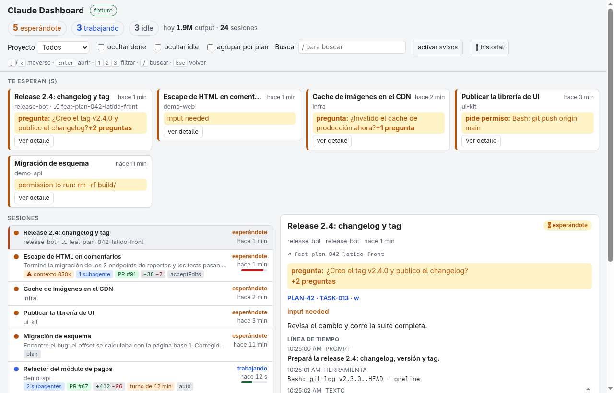
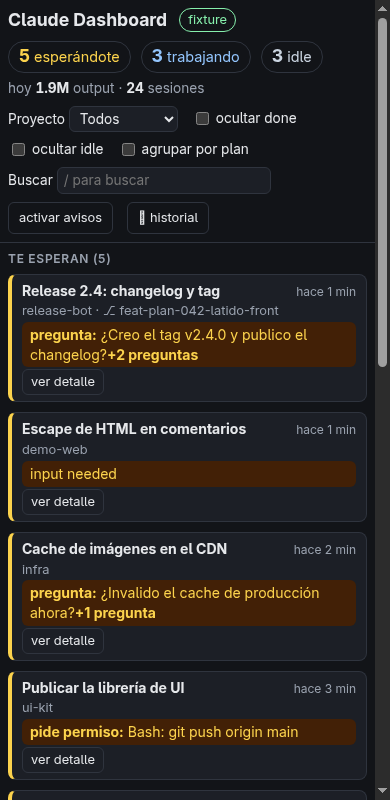

<div align="center">

# 🛰️ claude-dashboard

**La torre de control de tus sesiones de Claude Code.**

Tenés 15 sesiones abiertas. Una te está preguntando algo hace 20 minutos.
Este panel te dice **cuál**, **qué quiere** y **desde cuándo** — sin que abras una sola terminal.


<picture>
  <source media="(prefers-color-scheme: dark)" srcset="docs/img/readme-oscuro.png">
  
</picture>

</div>

---

## El problema

Claude Code te deja correr muchas sesiones en paralelo: interactivas, en background, workers que
levanta otro agente. Lo que no te da es **una vista de pájaro**. Y la sesión que más importa — la que
está **trabada esperando tu permiso** — es justo la que no hace ruido.

`claude-dashboard` es un daemon chiquito que mira tus sesiones cada 3 segundos y te muestra, en el
navegador, **primero lo que te necesita**.

## Qué vas a ver

**📥 Bandeja "te esperan".** Arriba de todo, las sesiones que están paradas por vos, con el motivo
en una línea: la pregunta que te hizo (`¿Creo el tag v2.4.0?` *+2 preguntas*), el comando que pide
permiso (`Bash: git push origin main`) o lo último que dijo.

**🧭 Todas las sesiones, ordenadas por urgencia.** Esperándote → trabajando → idle → terminadas. Cada
fila trae chips con lo que importa:

| Chip | Qué te dice |
|---|---|
| ⚠ `contexto 850k` | la ventana se está llenando: se viene una compactación |
| `2 subagentes` | cuántos subagentes están corriendo ahora mismo |
| `PR #87` | el último PR que abrió, con link |
| `+412 −96` | líneas agregadas y borradas en la sesión |
| `turno de 42 min` | lleva mucho en el mismo turno: ¿build largo o algo trabado? |
| `acceptEdits` · `auto` | el modo de permisos, si no es el default |
| `6 errores en 10 min` | ráfaga de errores de herramientas: algo se está rompiendo en loop |

**🔍 Detalle de cada sesión.** Último prompt, línea de tiempo de los últimos 20 eventos (prompt →
herramienta → respuesta), el resumen *"mientras no estabas"* que deja Claude cuando volvés, la rama
de git, el avance del plan (`PLAN-42 · 14/28 done · 4 blocked`) y los links a PRs y artifacts.

**📈 Historial de 30 días.** Tokens por día, por modelo y por proyecto. Sin dólares: solo uso.

**🔔 Avisos y favicon con contador.** El título de la pestaña dice `(5) esperándote` y el favicon
muestra el número; activá las notificaciones del navegador y te avisa cuando una sesión pasa a
esperarte.

**📱 Seguí en el teléfono.** Si la sesión tiene Remote Control, el panel dibuja un QR (localmente,
nada sale de tu máquina) para abrirla en el celular.

<div align="center">

</div>

**⌨️ Todo con teclado.** `j`/`k` para moverte, `Enter` para abrir, `1` `2` `3` para filtrar por
estado, `/` para buscar (también por `PR #N` o por repo), `Esc` para volver.

## Instalación

Necesitás **Linux o WSL con systemd `--user`**, **Go** (la versión de `go.mod`) para compilar y
**[Claude Code](https://claude.com/claude-code)** con `claude` en el `PATH`.

```bash
git clone https://github.com/snaven10/claude-dashboard.git
cd claude-dashboard
make install
```

Listo: abrí **<http://localhost:7777>**. El servicio arranca solo con tu sesión de usuario.

```bash
systemctl --user status claude-dashboard   # ¿está vivo?
make uninstall                             # lo saca todo y deja la máquina como estaba
```

¿Querés ver la interfaz sin instalar nada? Serví `web/` con cualquier servidor estático y abrí
`index.html?fixture`: carga datos de ejemplo.

## Ajustes

Todos son flags del binario (editá `ExecStart` en `deploy/claude-dashboard.service` si querés
cambiarlos de forma permanente):

| Flag | Default | Para qué |
|---|---|---|
| `-addr` | `127.0.0.1:7777` | dónde escucha (solo loopback, salvo `-allow-remote`) |
| `-interval` | `3s` | cada cuánto mira las sesiones |
| `-stale` | `10m` | una sesión trabajando sin actividad por más de esto se marca |
| `-context-warn` | `800000` | tokens de contexto a partir de los cuales avisa |
| `-rate-output` / `-rate-calls` | `20000` / `25` | umbrales de "ritmo inusual" en 5 minutos |
| `-errors-warn` | `5` | errores de herramientas en 10 minutos para marcar la sesión |
| `-history-interval` | `60s` | cada cuánto recalcula el historial (`0` lo apaga) |

## Cómo funciona

```
claude agents --json --all  ─┐
~/.claude/sessions/*.json   ─┼─► un solo poller (3 s) ─► snapshot ─► ¿cambió? ─► SSE ─► navegador
~/.claude/projects/**.jsonl ─┘        (lee solo la cola de cada transcript, incremental)
```

- **El estado** sale de `claude agents --json --all`, la interfaz pública de Claude Code.
- **El detalle** (pregunta pendiente, tokens, errores, PRs, subagentes…) sale de los transcripts
  locales, leyendo de forma incremental: un transcript de 50 MB no se relee en cada ciclo.
- **Un solo poller** para todos los navegadores abiertos, y solo emite si algo cambió.
- **Go stdlib + JS vanilla**, embebidos en un único binario. Cero dependencias, cero build de frontend.

La referencia completa de campos y endpoints está en **[docs/API.md](docs/API.md)**.

## Promesas

- 🔒 **Solo lectura.** No toca tus sesiones, no escribe en `~/.claude/`, no tiene botones que
  ejecuten nada. A lo sumo copia un comando al portapapeles.
- 🏠 **Solo local.** Escucha en `127.0.0.1` porque el panel muestra tus prompts. Un `-addr` no
  loopback se rechaza salvo que pases `-allow-remote` a propósito.
- 💸 **Sin costos en dólares.** Muestra tokens, no plata.
- 🧯 **Degrada, no se cae.** Los archivos de `~/.claude/` son formato interno de Claude Code: si
  cambian, el panel pierde detalle pero sigue mostrando el estado.

## Limitaciones honestas

- Latencia de hasta ~3 s: es polling, no hooks.
- Un permiso pendiente **no queda escrito** en el transcript: en una sesión esperándote se ve lo
  último que dijo Claude, no el diálogo de permiso exacto.
- Solo sesiones de tu máquina.

## Cómo se construyó

Este proyecto se hizo **con** Claude Code, plan por plan: cada funcionalidad tiene su diseño, sus
tareas y su verificación en [`plans/`](plans/). Si querés ver cómo se decidió algo — por qué no hay
hooks, por qué el contexto es absoluto y no un porcentaje — está ahí.

> Los SHAs citados en `plans/` son de antes de publicar el repo (el historial se reescribió para
> quitar datos privados) y ya no existen acá.

## Contribuir

Issues y PRs bienvenidos. Antes de mandar un cambio:

```bash
make test                     # go test -race ./...
node --test web/app.test.js   # tests del frontend
```

Una regla dura: **los fixtures de test son sintéticos**. Nunca pegues un transcript real de
`~/.claude/`: tiene tus prompts y los de tu trabajo.

## Licencia

[MIT](LICENSE) © 2026 snaven10
